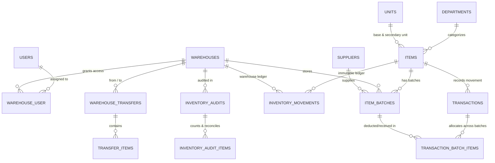

<div align="center">

[العربية](README.md) · **English**

# Enterprise Warehouse Management System (WMS)

### Multi-Warehouse Inventory, Batch/Lot Costing (FIFO / LIFO / FEFO / WAC), Append-Only Ledger & ERP Integration Platform

[](https://laravel.com)
[](https://php.net)
[](https://tailwindcss.com)
[](https://github.com/a-muaafa/Warehouse_management/actions/workflows/tests.yml)
[](public/openapi.yaml)
[](LICENSE)

</div>

---

## Overview

An enterprise-grade **Warehouse Management System (WMS)** built with **Laravel 13** and **PHP 8.3**, engineered for strict financial accuracy, multi-warehouse isolation, and tamper-proof inventory auditing.

### Key Capabilities

- **4 Inventory Valuation Engines:** Full batch-level costing supporting **FIFO** (First-In, First-Out), **LIFO** (Last-In, First-Out), **FEFO** (First-Expired, First-Out with automatic expired batch blocking), and **WAC** (Weighted Average Cost).
- **Multi-Batch Outbound Allocation:** Outbound issues spanning multiple batches are atomically tracked in `transaction_batch_items` with exact historical unit cost per batch.
- **Database-Enforced Append-Only Ledger:** Every stock receipt, issue, transfer, and audit adjustment writes to `inventory_movements` and `activity_logs`, protected at both the Eloquent model layer and the **database engine level (`BEFORE UPDATE` / `BEFORE DELETE` SQL triggers)** across MySQL, PostgreSQL, and SQLite.
- **7-Role RBAC & Warehouse-Level Isolation:** Granular policies (`Super Admin`, `Warehouse Manager`, `Inventory Manager`, `Storekeeper`, `Auditor`, `Viewer`) and `warehouse_user` pivot enforcement prevent horizontal privilege escalation across warehouses.
- **Multi-Stage Inter-Warehouse Transfers:** Full lifecycle (`draft` -> `pending` -> `approved` -> `in_transit` -> `partially_received` / `completed`) with shortage tracking (`received_quantity`, `missing_quantity`, `discrepancy_reason`) and automated return-to-source or write-off resolution.
- **Physical Inventory Audits & Stock Freeze:** Supports `periodic_full`, `spot_check`, and `cycle_count` sessions with optional `freeze_movements` lock and approval-gated financial reconciliation.
- **Action / DTO Domain Architecture:** Core domain mutations are encapsulated in `IssueStockAction`, `ReceiveStockAction`, and `ApproveTransferAction` with strongly-typed readonly DTOs (`IssueStockData`, `ReceiveStockData`) and pessimistic row locking (`SELECT ... FOR UPDATE`).

---

## Architecture & Entity-Relationship Diagram

See [`docs/erd.mmd`](docs/erd.mmd) for the standalone Mermaid schema.



---

## Installation & Setup

### 1. Local Development

```bash
git clone https://github.com/a-muaafa/Warehouse_management.git
cd Warehouse_management

composer install
npm install && npm run build

cp .env.example .env
php artisan key:generate

# Run migrations and seed demo accounts (local/testing only)
php artisan migrate --seed
php artisan serve
```

### 2. Production Deployment (Hardened)

> [!IMPORTANT]
> `DemoUsersSeeder` is automatically disabled when `APP_ENV=production`. Never use demo credentials in production. Use the `wms:create-admin` CLI command to provision your initial Super Admin with a minimum 12-character password.

```bash
composer install --no-dev --optimize-autoloader
npm ci && npm run build

php artisan migrate --force
php artisan db:seed --class=RolesAndPermissionsSeeder --force
php artisan wms:create-admin you@company.com admin

php artisan config:cache
php artisan route:cache
php artisan view:cache
```

---

## REST API v1 & Sanctum Integration

All API endpoints under `/api/v1` are protected by **Laravel Sanctum** token abilities (`read`, `write`) with a default 90-day token expiration (`SANCTUM_EXPIRATION=129600`) and `throttle:api` rate limiting (60 req/min).

### Issuing an ERP Integration Token

```php
$erp = User::where('username', 'erp_integration')->first();
$token = $erp->createToken('erp-sync', ['read', 'write'], now()->addDays(90));
echo $token->plainTextToken; // Displayed once
```

| Method | Endpoint | Required Ability | Description |
|--------|----------|------------------|-------------|
| `GET` | `/api/v1/stock-balances` | `read` | Paginated real-time stock balances & active batches |
| `GET` | `/api/v1/items/barcode/{code}` | `read` | Lookup item & batches by barcode or SKU |
| `GET` | `/api/v1/valuation-summary` | `read` | FIFO/LIFO/FEFO/WAC valuation & holding cost summary |
| `POST` | `/api/v1/transactions/external-sync` | `write` | Record inbound/outbound ERP movement with `idempotency_key` |

Interactive API documentation is available at `/api/docs` (powered by [`public/openapi.yaml`](public/openapi.yaml)).

---

## Testing & CI

The GitHub Actions pipeline ([`.github/workflows/tests.yml`](.github/workflows/tests.yml)) provisions a real **MySQL 8.0** service container to verify pessimistic row locks (`lockForUpdate()`), foreign key constraints, and `BEFORE UPDATE` / `BEFORE DELETE` database triggers.

```bash
php artisan test --compact
vendor/bin/pint --test
```

---

## License

Released under the [MIT License](LICENSE).

