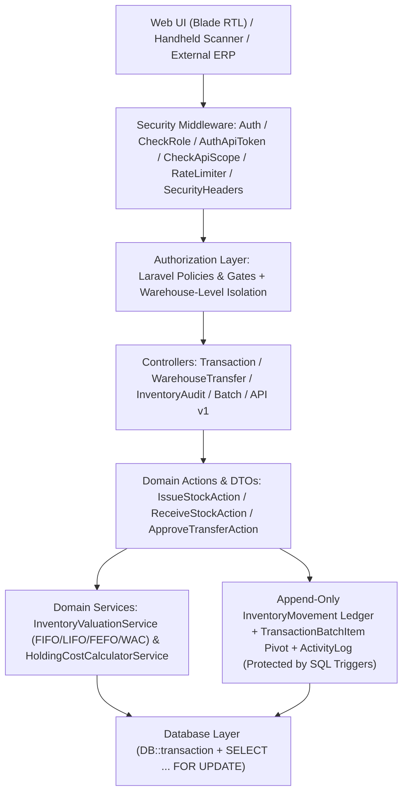
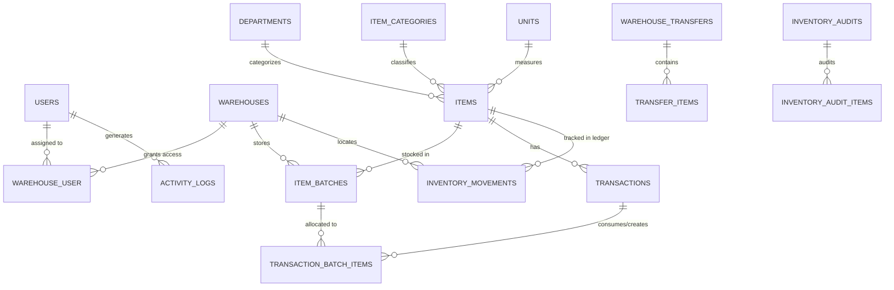

<div align="center">

**العربية** · [English](README.en.md)

<h1>نظام إدارة المستودعات والمخزون | Enterprise Warehouse Management System (WMS)</h1>

<p>
  نظام إلكتروني متكامل ومؤمّن لإدارة المستودعات المتعددة، تتبع الدفعات والتشغيلات (Batches)، سجل الحركات غير القابل للتعديل على مستوى قاعدة البيانات (Append-Only Ledger Triggers)، عمليات التحويل والجرد والتسوية، مع دعم كامل للغة العربية (RTL) والماسح الضوئي وواجهة برمجة التطبيقات (REST API v1).
</p>

[](https://laravel.com)
[](https://php.net)
[](https://laravel.com/docs/sanctum)
[](https://github.com/a-muaafa/Warehouse_management/actions/workflows/tests.yml)
[](README.md)
[](LICENSE)

</div>

---

## 1. نبذة عن المشروع والمشكلة التي يحلها

تعاني العديد من المؤسسات من تضارب الأرصدة المخزنية بين الفروع، وفقدان تتبع تواريخ الصلاحية وتكلفة الدفعات الفعلية عند الصرف أو التحويل بين المستودعات، بالإضافة إلى غياب سجل تدقيق صارم يوضح سبب تغير رصيد أي صنف.

يقدم **نظام إدارة المستودعات والمخزون (WMS)** حلاً هندسياً متكاملاً يعتمد على:
- **عزل صلاحيات المستودعات (Warehouse-Level Isolation)** عبر Policies وGates على الخادم.
- **سجل حركات مركزي غير قابل للتعديل (Immutable Append-Only Movement Ledger)** محمي على مستوى التطبيق ومستوى محرك قاعدة البيانات (`BEFORE UPDATE` / `BEFORE DELETE` Triggers) يوثق الرصيد قبل الحركة وبعدها ومصدرها والمستخدم المنفذ.
- **تخصيص دقيق للدفعات (FIFO / LIFO / FEFO / Weighted Average)** مع ربط كل حركة صرف بالدفعات المستهلكة عبر جدول وسيط (`transaction_batch_items`).
- **معمارية Actions & DTOs ومعالجة ذرية (`DB::transaction` + `lockForUpdate`)** لمنع السحب المتزامن والرصيد السالب وتكرار العمليات (`idempotency_key`).

---

## 2. المميزات الأساسية

1. **إدارة المستودعات المتعددة (Multi-Warehouse Management):**
   - ربط المستخدمين بمستودعات محددة عبر جدول `warehouse_user` ومنع الوصول لأي مستودع خارج نطاق الصلاحيات.
   - حساب تكلفة الاحتفاظ بالمخزون (Holding Cost) لكل مستودع بناءً على الدفعات النشطة الفعلية فيه.
2. **إدارة الدفعات والصلاحية (Batch & Lot Tracking):**
   - تتبع تاريخ الاستلام الفعلي (`received_at`)، تاريخ الإنتاج والانتهاء، تكلفة الوحدة، والكمية الأصلية والمتبقية بدقة عشرية (`decimal(15,4)`).
   - استبعاد الدفعات المنتهية الصلاحية تلقائياً عند الصرف، ودعم الحجر الصحي (Quarantine).
3. **تقييم المخزون المحاسبي (Inventory Valuation):**
   - التمييز الدقيق بين تقييم **FIFO**، وتقييم **LIFO**، وتقييم **FEFO**، وتقييم **Weighted Average Cost (المتوسط المرجح)**، وتقييم **Actual Batch Cost**.
4. **نظام التحويلات بين المستودعات (Inter-Warehouse Transfers):**
   - دورة حياة متكاملة: `Draft` -> `Pending` -> `Approved` -> `In Transit` -> `Partially Received / Completed / Discrepancy`.
   - تسجيل الكميات المرسلة والمستلمة والمفقودة (`missing_quantity`) وأسباب الفروقات، ومنع إغلاق التحويل بصورة عادية قبل تسوية الفروقات.
5. **نظام الجرد والتسويات (Inventory Audits & Reconciliation):**
   - دعم الجرد الكامل والجزئي، مع خيار **تجميد حركات المستودع (`freeze_movements`)** أثناء الجرد الفعلي.
   - فصل مرحلة إدخال العد الفعلي (`in_progress` -> `pending_approval`) عن مرحلة اعتماد التسوية (`reconciled`) التي تنشئ حركات التسوية الآلية.
6. **سجل التدقيق الشامل (Security & Audit Logs):**
   - توثيق محاولات الدخول الناجحة والفاشلة، والقيم القديمة والجديدة (`old_values` / `new_values`) عند تعديل الأصناف أو العمليات، مع منع التعديل أو الحذف عبر Database Triggers وحجب الحقول الحساسة.

---

## 3. التقنيات المستخدمة (Tech Stack)

- **Backend:** PHP 8.3+, Laravel 13.x, Laravel Sanctum
- **Architecture:** Action Classes (`IssueStockAction`, `ReceiveStockAction`, `ApproveTransferAction`), Readonly DTOs (`IssueStockData`, `ReceiveStockData`), Policies & Gates
- **Frontend:** Blade Templates (RTL Arabic), Custom CSS, JavaScript (ES6), Vite
- **Database:** MySQL 8.0 / MariaDB / PostgreSQL / SQLite (مع Triggers لحماية السجلات)
- **Quality & CI/CD:** PHPUnit 12, Laravel Pint, Composer Audit, GitHub Actions (MySQL 8.0 Service Container)

---

## 4. المعمارية الهندسية (System Architecture)



---

## 5. مخطط علاقات قاعدة البيانات (ERD Diagram)

ملف المخطط المستقل متوفر أيضاً في [`docs/erd.mmd`](docs/erd.mmd):



---

## 6. هيكل قاعدة البيانات الأساسية (Database Schema Highlights)

| الجدول | الغرض | أبرز الخصائص |
| :--- | :--- | :--- |
| `items` | سجل الأصناف الرئيسي | `decimal(15,4)` للكميات والأسعار، `valuation_method` (`fifo`, `lifo`, `fefo`, `avg`)، `SoftDeletes` |
| `item_batches` | دفعات وتشغيلات المخزون | `purchase_cost`, `quantity_received`, `quantity_remaining`, `expiry_date`, `received_at`, `transaction_id` |
| `transactions` | حركات الاستلام والصرف والتسوية | `type` (`in`/`out`)، `movement_reason`، `idempotency_key` لمنع التكرار، حماية من التعديل بعد الاكتمال |
| `transaction_batch_items` | الجدول الوسيط بين الحركات والدفعات | يوثق الكمية والتكلفة المسحوبة من كل دفعة على حدة في عمليات الصرف المتعددة |
| `inventory_movements` | **سجل حركات المخزون المركزي (Ledger)** | Append-Only عبر Triggers في قاعدة البيانات، يسجل `quantity_before`, `quantity_change`, `quantity_after` |
| `warehouse_transfers` & `transfer_items` | التحويلات بين المستودعات | حالات متكاملة (`draft`, `pending`, `approved`, `in_transit`, `partially_received`, `completed`, `discrepancy`)، `missing_quantity` |
| `inventory_audits` & `inventory_audit_items` | جلسات الجرد والتسوية | دعم `freeze_movements`، وحفظ الفروقات وأسبابها قبل اعتماد التسوية |
| `activity_logs` | سجل التدقيق الأمني | Append-Only عبر Triggers في قاعدة البيانات، يسجل `old_values`, `new_values`, `subject_type`, `ip_address` |

---

## 7. نظام الأدوار والصلاحيات (RBAC Matrix)

يطبق النظام مصفوفة صلاحيات خادم حقيقية عبر `config/permissions.php` و`App\Policies\*`:

| الدور (Role) | الصلاحيات الأساسية |
| :--- | :--- |
| **Super Admin (`super_admin`)** | جميع الصلاحيات والوصول الشامل لجميع المستودعات والأقسام وسجلات التدقيق. |
| **Warehouse Manager (`warehouse_manager`)** | إدارة المستودعات المخصصة له، اعتماد وإرسال واستلام وتسوية التحويلات، واعتماد الجرد. |
| **Inventory Manager (`inventory_manager`)** | إدارة الأصناف، البيانات الأساسية، إنشاء التحويلات والجرد واعتماد التسويات والتقارير. |
| **Storekeeper (`storekeeper`)** | تسجيل عمليات الاستلام (`stock.receive`) والصرف (`stock.issue`)، وإرسال واستلام التحويلات لمستودعاته. |
| **Stock Counter (`stock_counter`)** | إدخال نتائج العد الفعلي في جلسات الجرد المخصصة له وطباعة الملصقات. |
| **Auditor (`auditor`)** | مراجعة السجلات، التقارير، حركات المخزون، وسجل التدقيق (`activity_logs.view`) للقراءة والتصدير. |
| **Viewer (`viewer`)** | صلاحية القراءة فقط للمستودعات المسموح له بها دون إمكانية الإضافة أو التعديل. |

---

## 8. طريقة التثبيت والتشغيل

### المتطلبات الأساسية
- **PHP** >= 8.3
- **Composer** >= 2.x
- **Node.js** >= 18.x & NPM
- **Database:** MySQL 8.0+ / PostgreSQL / SQLite

### أولاً: التثبيت لبيئة التطوير المحلية (Local Development)

```bash
# 1. استنساخ المستودع
git clone https://github.com/a-muaafa/Warehouse_management.git
cd Warehouse_management

# 2. تثبيت اعتمادات PHP و Node
composer install
npm install

# 3. إنشاء ملف البيئة وتوليد مفتاح التشفير
cp .env.example .env
php artisan key:generate

# 4. تشغيل التهجيرات والبيانات التجريبية (للتطوير فقط)
php artisan migrate --seed

# 5. تجميع ملفات الواجهة الأمامية وتشغيل الخادم
npm run build
php artisan serve
```

### ثانياً: التثبيت الآمن في بيئة الإنتاج (Production Deployment)

> [!WARNING]
> يُمنع تشغيل `DemoUsersSeeder` في بيئة الإنتاج تلقائياً (`APP_ENV=production`). في بيئة الإنتاج، شغّل `RolesAndPermissionsSeeder` فقط ثم أنشئ حساب المدير الأول باستخدام الأمر الآمن `php artisan wms:create-admin` (يتطلب كلمة مرور لا تقل عن 12 حرفاً).

```bash
php artisan migrate --force
php artisan db:seed --class=RolesAndPermissionsSeeder --force
php artisan wms:create-admin you@company.com admin
```

---

## 9. متغيرات البيئة وإعدادات الإنتاج (Environment Variables)

| المتغير | القيمة الموصى بها في الإنتاج | الوصف |
| :--- | :--- | :--- |
| `APP_ENV` | `production` | يعطل حسابات الـ Demo Seeder ويفعّل HSTS وHTTPS الإجباري |
| `APP_DEBUG` | `false` | يمنع كشف تفاصيل الأخطاء الداخلية للمستخدم النهائي |
| `DB_CONNECTION` | `mysql` | محرك قاعدة البيانات (`mysql`, `pgsql`, `sqlite`) |
| `SESSION_SECURE_COOKIE` | `true` | يضمن إرسال الكوكيز عبر اتصال HTTPS مشفر فقط |
| `SANCTUM_EXPIRATION` | `129600` | مدة صلاحية رموز Sanctum بالدقائق (الافتراضي: 90 يوماً) |
| `WMS_ERP_TOKEN_HASH` | `sha256_hex_digest` | (اختياري) بصمة SHA-256 لرمز التكامل الاحتياطي بدلاً من النص الصريح |
| `WMS_ERP_TOKEN_EXPIRES_AT` | `2026-12-31T23:59:59Z` | (اختياري) تاريخ انتهاء صلاحية رمز التكامل الاحتياطي |

---

## 10. الحسابات التجريبية الافتراضية (في بيئة التطوير المحلي فقط)

عند تشغيل `php artisan migrate --seed` في بيئة `local` أو `testing`، يتم إنشاء الحسابات التالية (كلمة المرور: `password`):

| اسم المستخدم (`username`) | البريد الإلكتروني | الدور الفعلي | الوصف |
| :--- | :--- | :--- | :--- |
| `admin` | `admin@wms.com` | `super_admin` | المدير العام للنظام |
| `sup_food` | `sup.food@wms.com` | `inventory_manager` | مدير مخزون قسم الأغذية |
| `sup_pharma` | `sup.pharma@wms.com` | `inventory_manager` | مدير مخزون قسم الأدوية |
| `worker_entry` | `worker.entry@wms.com` | `storekeeper` | أمين مستودع (استلام وصرف) |
| `worker_audit` | `worker.audit@wms.com` | `stock_counter` | فاحص وعدّاد جرد |
| `worker_view` | `worker.view@wms.com` | `viewer` | مشاهد (قراءة فقط) |

---

## 11. توثيق واجهة برمجة التطبيقات (REST API v1 & Sanctum)

يعتمد النظام على **Laravel Sanctum** لإصدار رموز تكامل مقيدة بالنطاقات (`abilities:read`, `abilities:write`) ولها تاريخ انتهاء صلاحية محدد (`config/sanctum.php` مضبوط على 90 يوماً)، مع دعم التحقق الآمن عبر `hash_equals` لبصمات SHA-256.

### إصدار رمز تكامل لنظام ERP خارجي

```php
$erp = User::where('username', 'erp_integration')->first();
$token = $erp->createToken('erp-sync', ['read', 'write'], now()->addDays(90));
echo $token->plainTextToken; // يُعرض مرة واحدة فقط
```

توثيق **OpenAPI 3.0 / Swagger** الكامل متوفر في الملف: [`public/openapi.yaml`](public/openapi.yaml) وعبر المسار `/api/docs`.

### نقاط النهاية المتاحة (`/api/v1`)
- `GET /api/v1/stock-balances` (صلاحية `read`): استعراض الأرصدة مع دعم `per_page`, `warehouse_id`, `category_id`, `low_stock`, `search`, `sort_by`, `sort_dir`.
- `GET /api/v1/items/barcode/{code}` (صلاحية `read`): البحث عن صنف بالباركود أو رمز `SKU`.
- `GET /api/v1/valuation-summary` (صلاحية `read`): ملخص تقييم المخزون (`actual_batch_value`, `fifo_value`, `weighted_average_value`).
- `POST /api/v1/transactions/external-sync` (صلاحية `write`): تسجيل حركة مخزنية خارجية مع دعم `idempotency_key`.

---

## 12. واجهات النظام (Screenshots & UI Highlights)

- **لوحة التحكم التنفيذية (Executive Dashboard):** مؤشرات الأداء الفورية (KPIs)، تنبيهات الحد الأدنى، الدفعات القريبة من الانتهاء، وتكلفة الاحتفاظ بالمخزون لكل مستودع.
- **مركز الحركات المخزنية والماسح الضوئي (Scanner & Movement Hub):** دعم قارئات الباركود وطباعة ملصقات QR/Barcode الفورية عند التوريد.
- **إدارة التحويلات والجرد (Transfers & Audits Console):** تتبع مراحل الشحن والاعتماد وتسوية العجز والفروقات.
- **بوابة توثيق الـ API التفاعلية (`/api/docs`):** استعراض وتجربة نقاط نهاية REST API v1 مباشرة عبر مواصفات OpenAPI 3.0.

---

## 13. الاختبارات والتكامل المستمر (Testing & CI/CD on MySQL 8.0)

يعمل خط أنابيب **GitHub Actions** ([`.github/workflows/tests.yml`](.github/workflows/tests.yml)) على حاوية **MySQL 8.0** حقيقية لاختبار الأقفال التشاؤمية (`SELECT ... FOR UPDATE`)، قيود المفاتيح الأجنبية، وقوادح منع التعديل والحذف (`BEFORE UPDATE` / `BEFORE DELETE` Triggers) على سجلات الحركات والتدقيق.

```bash
# تشغيل جميع الاختبارات
php artisan test --compact

# فحص تنسيق الكود وفق معايير Laravel Pint
vendor/bin/pint --test

# فحص ثغرات المكتبات
composer audit
```

---

## 14. خارطة الطريق المستقبلية (Roadmap)

- [x] محرك تقييم الدفعات المتعدد (FIFO / LIFO / FEFO / Weighted Average)
- [x] سجل حركات مركزي غير قابل للتعديل على مستوى قاعدة البيانات (Append-Only SQL Triggers)
- [x] عزل المستودعات ومصفوفة الصلاحيات السباعية (7-Role RBAC & Policies)
- [x] معمارية Actions & Readonly DTOs للعمليات المخزنية الحرجة
- [ ] إشعارات فورية عبر WebSockets (Laravel Reverb) عند وصول الأصناف للحد الحرج
- [ ] دعم المواقع الفرعية داخل المستودع (Aisle / Rack / Shelf / Bin Locations)
- [ ] تطبيق جوال مخصص للماسح الضوئي يعمل دون اتصال (Offline-First PWA Scanner)

---

## 15. المساهمة والترخيص (Contributing & License)

نرحب بالمساهمات عبر فتح Pull Request مع التأكد من نجاح جميع الاختبارات (`php artisan test`) واجتياز فحص التنسيق (`vendor/bin/pint`).
هذا المشروع مرخص بموجب رخصة **[MIT License](LICENSE)**.
