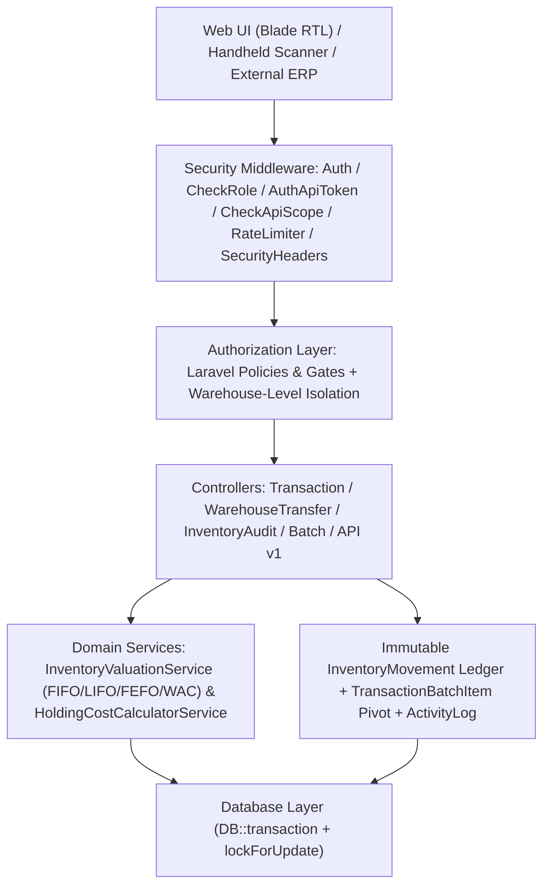
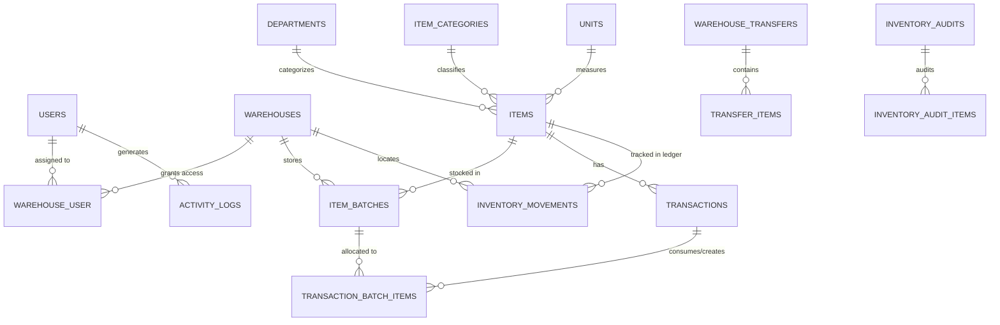

<p align="center">
  <h1 align="center">نظام إدارة المستودعات والمخزون | Enterprise Warehouse Management System (WMS)</h1>
  <p align="center">
    نظام إلكتروني متكامل ومؤمّن لإدارة المستودعات المتعددة، تتبع الدفعات والتشغيلات (Batches)، سجل الحركات غير القابل للتعديل (Immutable Movement Ledger)، عمليات التحويل والجرد والتسوية، مع دعم كامل للغة العربية (RTL) والماسح الضوئي وواجهة برمجة التطبيقات (REST API v1).
  </p>
</p>

<p align="center">
  
  
  
  
  
  
</p>

---

## 1. نبذة عن المشروع والمشكلة التي يحلها

تعاني العديد من المؤسسات من تضارب الأرصدة المخزنية بين الفروع، وفقدان تتبع تواريخ الصلاحية وتكلفة الدفعات الفعلية عند الصرف أو التحويل بين المستودعات، بالإضافة إلى غياب سجل تدقيق صارم يوضح سبب تغير رصيد أي صنف.

يقدم **نظام إدارة المستودعات والمخزون (WMS)** حلاً هندسياً متكاملاً يعتمد على:
- **عزل صلاحيات المستودعات (Warehouse-Level Isolation)** عبر Policies وGates على الخادم.
- **سجل حركات مركزي غير قابل للتعديل (Immutable Inventory Movement Ledger)** يوثق الرصيد قبل الحركة وبعدها ومصدرها والمستخدم المنفذ.
- **تخصيص دقيق للدفعات (FIFO / LIFO / FEFO / Weighted Average)** مع ربط كل حركة صرف بالدفعات المستهلكة عبر جدول وسيط (`transaction_batch_items`).
- **معالجة ذرية (Database Transactions & Row-Level Locking)** باستخدام `lockForUpdate()` لمنع السحب المتزامن والرصيد السالب وتكرار العمليات.

---

## 2. المميزات الأساسية

1. **إدارة المستودعات المتعددة (Multi-Warehouse Management):**
   - ربط المستخدمين بمستودعات محددة عبر جدول `warehouse_user` ومنع الوصول لأي مستودع خارج نطاق الصلاحيات.
   - حساب تكلفة الاحتفاظ بالمخزون (Holding Cost) لكل مستودع بناءً على الدفعات النشطة الفعلية فيه.
2. **إدارة الدفعات والصلاحية (Batch & Lot Tracking):**
   - تتبع تاريخ الاستلام الفعلي (`received_at`)، تاريخ الإنتاج والانتهاء، تكلفة الوحدة، والكمية الأصلية والمتبقية بدقة عشرية (`decimal(15,4)`).
   - استبعاد الدفعات المنتهية الصلاحية تلقائياً عند الصرف، ودعم الحجر الصحي (Quarantine).
3. **تقييم المخزون المحاسبي (Inventory Valuation):**
   - التمييز الدقيق بين تقييم **FIFO**، وتقييم **Weighted Average Cost (المتوسط المرجح)**، وتقييم **Actual Batch Cost**.
4. **نظام التحويلات بين المستودعات (Inter-Warehouse Transfers):**
   - دورة حياة متكاملة: `Draft` -> `Pending` -> `Approved` -> `In Transit` -> `Partially Received / Completed / Discrepancy`.
   - تسجيل الكميات المرسلة والمستلمة والمفقودة (`missing_quantity`) وأسباب الفروقات، ومنع إغلاق التحويل بصورة عادية قبل تسوية الفروقات.
5. **نظام الجرد والتسويات (Inventory Audits & Reconciliation):**
   - دعم الجرد الكامل والجزئي، مع خيار **تجميد حركات المستودع (`freeze_movements`)** أثناء الجرد الفعلي.
   - فصل مرحلة إدخال العد الفعلي (`in_progress` -> `pending_approval`) عن مرحلة اعتماد التسوية (`reconciled`) التي تنشئ حركات التسوية الآلية.
6. **سجل التدقيق الشامل (Security & Audit Logs):**
   - توثيق محاولات الدخول الناجحة والفاشلة، والقيم القديمة والجديدة (`old_values` / `new_values`) عند تعديل الأصناف أو العمليات، مع منع حذف السجل وحجب الحقول الحساسة.

---

## 3. التقنيات المستخدمة (Tech Stack)

- **Backend:** PHP 8.3+, Laravel 13.x, Laravel Sanctum
- **Frontend:** Blade Templates (RTL Arabic), Custom CSS, JavaScript (ES6), Vite
- **Database:** MySQL / MariaDB / PostgreSQL / SQLite
- **Quality & CI/CD:** PHPUnit 12, Laravel Pint, Composer Audit, GitHub Actions

---

## 4. المعمارية الهندسية (System Architecture)



---

## 5. مخطط علاقات قاعدة البيانات (ERD Diagram)



---

## 6. هيكل قاعدة البيانات الأساسية (Database Schema Highlights)

| الجدول | الغرض | أبرز الخصائص |
| :--- | :--- | :--- |
| `items` | سجل الأصناف الرئيسي | `decimal(15,4)` للكميات والأسعار، `valuation_method` (`fifo`, `lifo`, `fefo`, `avg`)، `SoftDeletes` |
| `item_batches` | دفعات وتشغيلات المخزون | `purchase_cost`, `quantity_received`, `quantity_remaining`, `expiry_date`, `received_at`, `transaction_id` |
| `transactions` | حركات الاستلام والصرف والتسوية | `type` (`in`/`out`)، `movement_reason`، `idempotency_key` لمنع التكرار، حماية من التعديل بعد الاكتمال |
| `transaction_batch_items` | الجدول الوسيط بين الحركات والدفعات | يوثق الكمية والتكلفة المسحوبة من كل دفعة على حدة في عمليات الصرف المتعددة |
| `inventory_movements` | **سجل حركات المخزون المركزي (Ledger)** | غير قابل للتعديل أو الحذف، يسجل `quantity_before`, `quantity_change`, `quantity_after`, `source_type/id` |
| `warehouse_transfers` & `transfer_items` | التحويلات بين المستودعات | حالات متكاملة (`draft`, `pending`, `approved`, `in_transit`, `partially_received`, `completed`, `discrepancy`)، `missing_quantity` |
| `inventory_audits` & `inventory_audit_items` | جلسات الجرد والتسوية | دعم `freeze_movements`، وحفظ الفروقات وأسبابها قبل اعتماد التسوية |
| `activity_logs` | سجل التدقيق الأمني | يسجل `old_values`, `new_values`, `subject_type`, `ip_address` ومحمية ضد الحذف |

---

## 7. نظام الأدوار والصلاحيات (RBAC Matrix)

يطبق النظام مصفوفة صلاحيات خادم حقيقية عبر `config/permissions.php` و`App\Policies\*`:

| الدور (Role) | الصلاحيات الأساسية |
| :--- | :--- |
| **Super Admin (`super_admin`)** | جميع الصلاحيات والوصول الشامل لجميع المستودعات والأقسام وسجلات التدقيق. |
| **Warehouse Manager (`warehouse_manager`)** | إدارة المستودعات المخصصة له، اعتماد وإرسال واستلام وتسوية التحويلات، واعتماد الجرد. |
| **Inventory Manager (`inventory_manager`)** | إدارة الأصناف، البيانات الأساسية، إنشاء التحويلات والجرد واعتماد التسويات والتقارير. |
| **Storekeeper (`storekeeper`)** | تسجيل عمليات الاستلام (`stock.receive`) والصرف (`stock.issue`)، وإرسال واستلام التحويلات لمستودعاته. |
| **Stock Counter (`stock_counter`)** | إدخال نتائج العد الفعلي في جلسات الجرد المخصصة له وطباعة الملصقات. |
| **Auditor (`auditor`)** | مراجعة السجلات، التقارير، حركات المخزون، وسجل التدقيق (`activity_logs.view`) للقراءة والتصدير. |
| **Viewer (`viewer`)** | صلاحية القراءة فقط للمستودعات المسموح له بها دون إمكانية الإضافة أو التعديل. |

---

## 8. طريقة التثبيت والتشغيل المحلي

### المتطلبات الأساسية
- **PHP** >= 8.3
- **Composer** >= 2.x
- **Node.js** >= 18.x & NPM

### خطوات التثبيت

```bash
# 1. استنساخ المستودع
git clone https://github.com/a-muaafa/Warehouse_management.git
cd Warehouse_management

# 2. تثبيت اعتمادات PHP و Node
composer install
npm install

# 3. إنشاء ملف البيئة وتوليد مفتاح التشفير
cp .env.example .env
php artisan key:generate

# 4. تشغيل التهجيرات والبيانات الأولية
php artisan migrate --seed

# 5. تجميع ملفات الواجهة الأمامية وتشغيل الخادم
npm run build
php artisan serve
```

---

## 9. إعدادات بيئة الإنتاج الآمنة (Production Security)

عند نشر النظام في بيئة الإنتاج، تأكد من ضبط القيم التالية في ملف `.env`:

```env
APP_ENV=production
APP_DEBUG=false
APP_URL=https://your-domain.com

SESSION_SECURE_COOKIE=true
SESSION_HTTP_ONLY=true
SESSION_SAME_SITE=lax
```

- يتم تفعيل `URL::forceScheme('https')` وترويسات الأمان (`Strict-Transport-Security`, `X-Frame-Options`, `X-Content-Type-Options`, `Referrer-Policy`, `Permissions-Policy`) تلقائياً.

---

## 10. الحسابات التجريبية الافتراضية (Demo Accounts)

عند تشغيل `php artisan db:seed` يتم إنشاء الحسابات التالية للتجربة المحلية (كلمة المرور لجميع الحسابات: `password`):

| اسم المستخدم (`username`) | البريد الإلكتروني | الدور الفعلي | الوصف |
| :--- | :--- | :--- | :--- |
| `admin` | `admin@wms.com` | `super_admin` | المدير العام للنظام |
| `sup_food` | `sup.food@wms.com` | `inventory_manager` | مدير مخزون قسم الأغذية |
| `sup_pharma` | `sup.pharma@wms.com` | `inventory_manager` | مدير مخزون قسم الأدوية |
| `worker_entry` | `worker.entry@wms.com` | `storekeeper` | أمين مستودع (استلام وصرف) |
| `worker_audit` | `worker.audit@wms.com` | `stock_counter` | فاحص وعدّاد جرد |
| `worker_view` | `worker.view@wms.com` | `viewer` | مشاهد (قراءة فقط) |

---

## 11. توثيق واجهة برمجة التطبيقات (REST API v1 & OpenAPI)

جميع نقاط النهاية محمية بواسطة `auth.api_token` (تقبل رموز **Laravel Sanctum** مع التحقق من الصلاحيات وانتهاء الصلاحية، أو رموز التكامل المعرفة في البيئة) ومحمية بـ Rate Limiting (`throttle:api`).

توثيق **OpenAPI 3.0 / Swagger** الكامل متوفر في الملف: [`public/openapi.yaml`](public/openapi.yaml).

### نقاط النهاية المتاحة (`/api/v1`)
- `GET /api/v1/stock-balances` (نطاق `read`): استعراض الأرصدة مع دعم `per_page`, `warehouse_id`, `category_id`, `low_stock`, `search`, `sort_by`, `sort_dir`.
- `GET /api/v1/items/barcode/{code}` (نطاق `read`): البحث عن صنف بالباركود أو رمز `SKU`.
- `GET /api/v1/valuation-summary` (نطاق `read`): ملخص تقييم المخزون (`actual_batch_value`, `fifo_value`, `weighted_average_value`).
- `POST /api/v1/transactions/external-sync` (نطاق `write`): تسجيل حركة مخزنية خارجية مع دعم `idempotency_key`.

مثال للاستجابة الموحدة:
```json
{
  "success": true,
  "status": "success",
  "message": "Transaction created successfully",
  "data": {
    "id": 101,
    "type": "stock_in",
    "warehouse_id": 1,
    "new_balance": 150
  }
}
```

---

## 12. الاختبارات والتكامل المستمر (Testing & CI/CD)

يحتوي المشروع على **60 اختباراً آلياً (Unit & Feature Tests)** بأكثر من 210 تحقق (Assertions) تغطي العمليات الحسابية (FIFO / LIFO / FEFO / WAC)، تحويلات الوحدات المتسلسلة، الصلاحيات وعزل المستودعات، التحويلات الجزئية، الجرد والتسويات، وسجل الحركات غير القابل للتعديل.

```bash
# تشغيل جميع الاختبارات
php artisan test

# فحص تنسيق الكود وفق معايير Laravel Pint
vendor/bin/pint --test

# فحص ثغرات المكتبات
composer audit
```

يعمل خط أنابيب **GitHub Actions** (`.github/workflows/tests.yml`) تلقائياً عند كل `push` أو `pull_request`.

---

## 13. المساهمة والترخيص (Contributing & License)

نرحب بالمساهمات عبر فتح Pull Request مع التأكد من نجاح جميع الاختبارات (`php artisan test`) واجتياز فحص التنسيق (`vendor/bin/pint`).
هذا المشروع مرخص بموجب رخصة **[MIT License](LICENSE)**.
